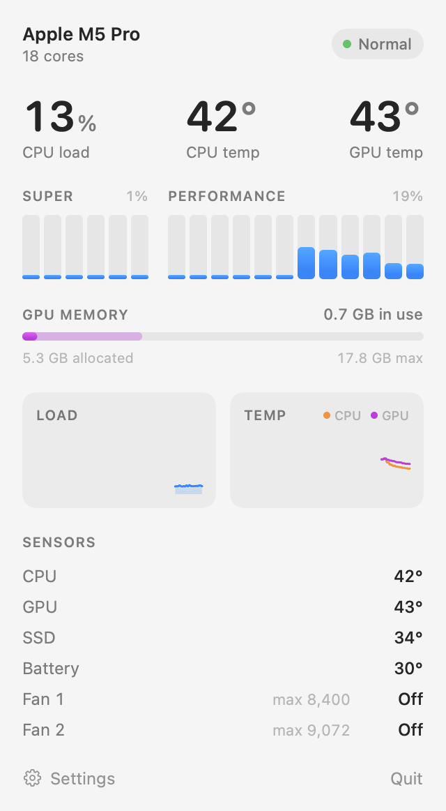

# Cores

A clean, lightweight menu bar monitor for Macs with Apple silicon.

  <picture>
    <source media="(prefers-color-scheme: dark)" srcset="docs/panel-dark.png">
    
  </picture>

Cores shows your CPU load and temperature in the menu bar. Click it to see:

- **Every core at a glance**, grouped by core type
- **CPU and GPU temperature**, with the last minute of history
- **GPU memory** in use
- **SSD and battery temperature** and **fan speeds**
- **Thermal status**: whether macOS considers your Mac warm or hot

It uses almost no CPU itself and keeps itself up to date.

## Download

**[Download Cores](https://github.com/Jam0r85/Cores/releases/latest/download/Cores.dmg)**, open it and drag Cores into your Applications folder. To have it start when you log in, open the dropdown and choose Settings → Open at login.

Requires a Mac with Apple silicon and macOS 14 or later.
